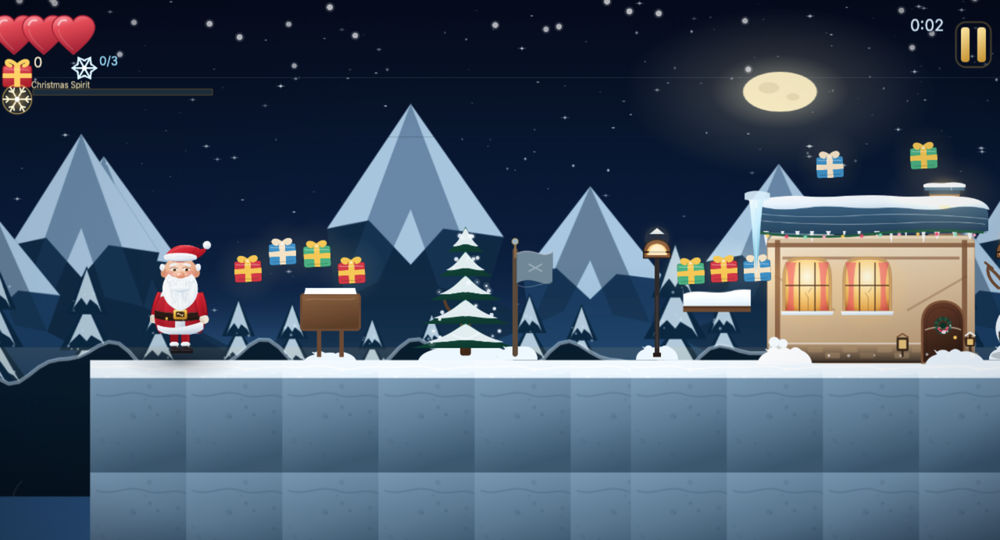

# Santa's Christmas Journey

A complete, hand-crafted 2D Christmas platformer for **Web, Android, iOS and Desktop** from one TypeScript codebase. Guide Santa through five snow-dusted towns, deliver presents down chimneys, rescue the Christmas spirit and face Krampus at the North Pole.

Built with **Phaser 3 + TypeScript + Vite**, wrapped by **Capacitor** for mobile and **Electron** for desktop. Every character, house, tile, background and icon is generated from hand-authored SVG source in this repository — there are no third-party game-art or audio downloads.



## Highlights

- **Five themed towns** — Snowy Pine Village, Gingerbread Town, Toy Factory District, Frozen Forest and North Pole Summit — with unique tiles, parallax skies, hazards, enemies and music.
- **A fully layered Santa rig** — 29 hand-drawn SVG frames for idle, walk, run, jump, fall, slide, hurt, throw and victory, rendered at 2× for retina screens.
- **Present-delivery platforming** — collect presents, climb onto roofs and post them down glowing chimneys to open the route to the next town.
- **Krampus boss fight** — a three-hit arena battle with projectiles, slams and a closing gate.
- **Real platformer feel** — acceleration, coyote time, jump buffering, variable-height jumps, double jump, slide, ground pound, stomp bounces, ice and sticky surfaces.
- **Accessibility built in** — keyboard, gamepad and touch controls, a screen-reader menu mirror with live announcements, colourblind hazard cues, reduced motion, film-grain toggle, large text and adjustable touch-control size/opacity.
- **Localisation** — English, Spanish, German and Bulgarian, with Latin and Cyrillic font subsets.
- **Up to six save profiles** — progress, stars, best times/scores, 12 achievements and settings, persisted with Capacitor Preferences and a `localStorage` fallback.
- **PWA + offline play** — installable fullscreen landscape app with a generated service-worker precache. Android and iOS apps are locked to landscape; Electron provides a fullscreen desktop build.
- **Small footprint** — the complete procedural art set is about **4.8 MB**; the production web bundle is roughly **8.6 MB** on disk (Phaser included).

## Quick start

Requirements: **Node.js 20+** and npm.

```bash
npm install
npm run dev
```

Open <http://localhost:5173>. The first `npm run dev` runs the SVG art pipeline automatically and writes the runtime assets to `public/assets/generated`.

> If your environment blocks Electron's binary download during `npm install`, use `ELECTRON_SKIP_BINARY_DOWNLOAD=1 npm install`. Web, Android and iOS development still work; desktop packaging needs the Electron binary.

### Controls

| Action | Keyboard | Gamepad | Touch |
| --- | --- | --- | --- |
| Move | `←` `→` / `A` `D` | Left stick / D-pad | Virtual joystick |
| Jump / double jump | `Space` / `↑` / `W` | `A` | Jump button |
| Run | `Shift` | `X` | Run button |
| Slide / ground pound | `↓` / `S` | `B` / `↓` | Slide button |
| Deliver present | `E` | `Y` | Gift button |
| Pause | `Esc` / `P` | Start | Pause button |
| Confirm menu | `Enter` / `Space` | `A` | Tap |
| Back | `Esc` | `B` | Back button |

Santa can double jump, slide under hazards and ground-pound crumbling platforms. A stomp from above defeats most enemies; collecting enough presents fills the Christmas-spirit meter and grants temporary invincibility.

## Project layout

```
assets/
  fonts/                  Cinzel + Inter woff2 files and OFL licences
  audio/music/            Eight JSON music scores (procedural WebAudio)
  svg/                    Generated SVG frames, backgrounds, tiles and manifest
build/                    Desktop packaging icons (generated)
dev/                      Art contact sheet and Santa preview
electron/                 Electron main process
public/                   PWA manifest, service worker, generated runtime assets
scripts/
  art/                    SVG art system (Santa, enemies, houses, environment, UI)
  generate-art.mjs        SVG generator + manifest + previews
  build-assets.mjs        Sharp rasteriser, atlas packer, PWA icons
  generate-levels.mjs     Level-authoring DSL for the five towns
  validate-levels.mjs     Structural level validator
  build-native-assets.mjs Native app icons and splash screens
  smoke-electron.cjs      Electron boot smoke test
src/
  scenes/                 Boot, Preload, Splash, menus, Game, UI, Pause, LevelComplete
  entities/               Santa, enemies, Krampus, houses, presents, hazards, platforms
  systems/                Save, progress/achievements, i18n, input, audio, art, a11y
  levels/                 Generated level JSON
  ui/MenuKit.ts           Shared menu buttons/backgrounds
tests/                    Vitest unit and level-invariant tests
```

## Scripts

| Command | What it does |
| --- | --- |
| `npm run dev` | Generate assets, then start the Vite dev server. |
| `npm run build` | Generate + validate levels, generate art, typecheck and build `dist/`. |
| `npm run preview` | Serve the production build locally. |
| `npm run typecheck` | `tsc --noEmit`. |
| `npm test` | Run the Vitest suite. |
| `npm run art` | Regenerate SVG source, manifest and `dev/art-preview.html`. |
| `npm run assets` | Run art + rasterise atlases and runtime images. |
| `npm run levels` | Regenerate the five level JSON files from the DSL. |
| `npm run validate:levels` | Check level structure and print warnings. |
| `npm run native:assets` | Generate Android/iOS/desktop icons and splash screens. |
| `npm run android:sync` | Build the web app and copy it into the Android project. |
| `npm run android:apk` | Build + sync + assemble a debug APK. |
| `npm run android:aab` | Build + sync + assemble a release AAB. |
| `npm run ios:sync` | Build the web app, copy it into iOS and run `pod install`. |
| `npm run desktop:dev` | Build and launch the Electron app. |
| `npm run desktop:build` | Build installers with electron-builder. |
| `npm run smoke:electron` | Build and verify that Electron boots into the game. |

## Production web + PWA

```bash
npm run build
npm run preview
```

Deploy the contents of `dist/` to any static host. The build uses relative URLs, so it also works from a subdirectory. Service workers require **HTTPS** (or `localhost`); registration is skipped automatically for `file://` (Electron). The Vite build plugin rewrites `public/sw.js` with a hashed cache version and a complete precache list, so a normal first visit is enough for full offline play. The Electron app also skips service-worker registration because `file://` cannot be cached.

## Android

The native project lives in `android/` (Capacitor 6, `com.christmasjourney.santa`). It is configured for:

- `minSdkVersion 24`, `targetSdkVersion 34`, `compileSdkVersion 36`;
- `sensorLandscape` orientation, fullscreen, edge-to-edge dark system bars;
- the generated Santa app icon and adaptive icon;
- Preferences persistence through `@capacitor/preferences`.

Build requirements: **JDK 21** (Gradle 8.11.1 / AGP 8.10.1 do not run on JDK 25) and the Android SDK with API 36.

```bash
npm run android:sync
npm run android:open       # open in Android Studio
npm run android:apk        # debug APK at android/app/build/outputs/apk/debug/
```

### Release AAB and signing

Create a keystore once, then keep the credentials out of git:

```bash
keytool -genkeypair -v -keystore android/santa-release.jks \
  -alias santa -keyalg RSA -keysize 2048 -validity 10000
```

Create `android/keystore.properties` (already gitignored):

```properties
storeFile=../santa-release.jks
storePassword=…
keyAlias=santa
keyPassword=…
```

Then run `npm run android:aab`. The Gradle signing block picks the file up automatically and writes `android/app/build/outputs/bundle/release/app-release.aab`. Without `keystore.properties` the release bundle is unsigned, which is useful for CI smoke builds but cannot be uploaded to Google Play.

## iOS

The native project lives in `ios/` and requires macOS with Xcode and CocoaPods. It is locked to landscape, fullscreen, with the generated app icon and launch image.

```bash
npm run ios:sync
npm run ios:open           # open ios/App/App.xcworkspace
```

In Xcode select your team/bundle identifier, then run on a device or archive for distribution. The simulator scheme builds with:

```bash
xcodebuild -workspace ios/App/App.xcworkspace -scheme App \
  -configuration Debug -sdk iphonesimulator \
  -destination 'generic/platform=iOS Simulator' \
  -derivedDataPath "$TMPDIR/scj-ios" CODE_SIGNING_ALLOWED=NO build
```

## Desktop (Electron)

The main process is hardened with `contextIsolation`, `sandbox`, no Node integration and no remote content. It loads the local production build, blocks in-app navigation and opens external HTTPS links in the system browser.

```bash
npm run desktop:dev        # build + launch
npm run desktop:build      # installers for the current OS
```

electron-builder targets macOS (`dmg`, `zip`), Windows (`nsis`, `portable`) and Linux (`AppImage`, `deb`). macOS builds are unsigned by default; configure signing/notarisation before distribution. The packaged app was smoke-tested end-to-end (game boots, scenes start, Santa spawns).

## Art pipeline

All art is authored as SVG in `scripts/art/`:

- `lib.mjs` — deterministic RNG, gradients, fur/glow/blur filters, stars, ridges, icicles, snow caps.
- `santa.mjs` — the layered Santa rig and all 29 frames.
- `enemies.mjs` — nine enemy types, Krampus, reindeer, sleigh and projectiles.
- `houses.mjs` — 15 town house variants plus the goal tree.
- `environment.mjs` — 15 seamless parallax backgrounds, tiles, props and effects.
- `ui.mjs` — nine-slice panels, buttons, hearts, stars, icons and the app icon.

```bash
npm run art       # SVG source → assets/svg + manifest + dev previews
npm run assets    # SVG → retina atlases/images in public/assets/generated
```

`scripts/build-assets.mjs` rasterises characters/UI at 2×, houses at 1.5× and backgrounds at 1× with Sharp, shelf-packs four atlases (`santa`, `enemies`, `props`, `ui`) and emits TexturePacker JSON. Open `dev/art-preview.html` or `dev/santa-preview.html` through the dev server to inspect frames. The generator rejects duplicate frame names and the build fails on missing assets.

To change Santa, edit the frame definitions in `scripts/art/santa.mjs`, then run `npm run assets`. Animation keys and frame ranges live in `src/systems/animations.ts`.

## Level authoring

The five JSON files in `src/levels/` are generated by `scripts/generate-levels.mjs` and must pass `scripts/validate-levels.mjs` during every production build. The DSL uses three areas per level, five to eight houses, checkpoints, hazards, secrets and a boss arena for the summit.

Coordinate system: origin top-left, **y increases downward**, `groundY` is the walkable surface (760 in the shipped levels). Platforms use `x, y` as the **top-left** corner. Houses are centred on `x` with a 320 px footprint, a roof 208 px above the ground and a chimney at `x + 98`. Secrets are chambers reached with spring hazards; the summit's `boss` block defines `triggerX`, `gateX` and the arena bounds. The full schema is in `src/types.ts`.

Typical loop:

```bash
npm run levels
npm run validate:levels
npm run dev
```

Hand-editing the generated JSON is fine for experiments, but the next `npm run levels` overwrites it. Add new content in the DSL so it stays validated.

## Systems notes

- **Save data** — `santas-christmas-journey.save.v1`; sanitised on load, debounced writes, six profiles, achievements, best score/time and settings. Preferences is used on native; `localStorage` is the web fallback.
- **Scoring** — presents ×50, deliveries ×100, secrets ×200, stomps ×25, remaining-time bonus ×5, plus 500 for every chimney served. Three stars require every gift and every secret.
- **Audio** — fully procedural WebAudio synthesizer and sequencer; eight JSON scores (menu, jingle, Tannenbaum, workshop, Silent Night, bells, boss, victory) with pads, bass, lead and drums. No audio files to download or license.
- **Input** — unified keyboard, gamepad and touch layer with jump buffering and coyote time. Touch controls scale and fade from Settings.
- **Accessibility** — a hidden DOM menu mirrors every screen for screen readers, status updates are announced through an `aria-live` region, canvas has a descriptive label, colourblind mode adds hazard markers and numeric hearts, reduced motion disables shakes/grain/dense snow, and large text enlarges menus and HUD text.
- **Localisation** — `t(key, vars)` with `{name}` interpolation and English fallback. To add a language, extend `Language` in `src/types.ts`, add a dictionary in `src/systems/i18n.ts`, add it to `LANGUAGES`, and include any needed font subset.

## Tests and validation

```bash
npm run typecheck
npm test
npm run validate:levels
npm run smoke:electron
```

The Vitest suite covers profile sanitisation, achievements/unlocks, scoring/stars, level invariants, all music track parsing and i18n. The Electron smoke script boots the production build, starts a level and reports scene/Santa/canvas state plus a screenshot.

## Credits and licences

- Code and generated art: MIT (see `LICENSE`).
- **Cinzel** and **Inter** fonts: SIL Open Font License 1.1; licence texts ship in `assets/fonts/` and `public/licenses/`.
- Music: original compositions plus public-domain carols (*Jingle Bells*, *O Tannenbaum*, *Silent Night*), arranged procedurally in this repository.
- Built with [Phaser](https://phaser.io), [Vite](https://vite.dev), [Capacitor](https://capacitorjs.com), [Electron](https://www.electronjs.org), [Sharp](https://sharp.pixelplumbing.com) and [Vitest](https://vitest.dev).

## Troubleshooting

- **Blank/black page** — run `npm run assets` and hard-reload; check the browser console for a missing atlas or a stale service worker (Application → Service Workers → Unregister, then reload).
- **Gradle fails with “Unsupported class file major version”** — point `JAVA_HOME` at JDK 21. The Android wrapper is Gradle 8.11.1 with AGP 8.10.1.
- **`pod install` fails** — run `cd ios/App && pod repo update`, then `npm run ios:sync`.
- **Electron binary missing** — reinstall Electron with network access, or set `ELECTRON_CACHE` to a writable directory before running `node node_modules/electron/install.js`.
- **Offline play needs a second reload** — make sure the build contains the generated `dist/sw.js` with a precache list (run `npm run build`, not just `vite build`), and serve it over HTTPS/localhost.

Merry Christmas, and safe travels! 🎅🛷
